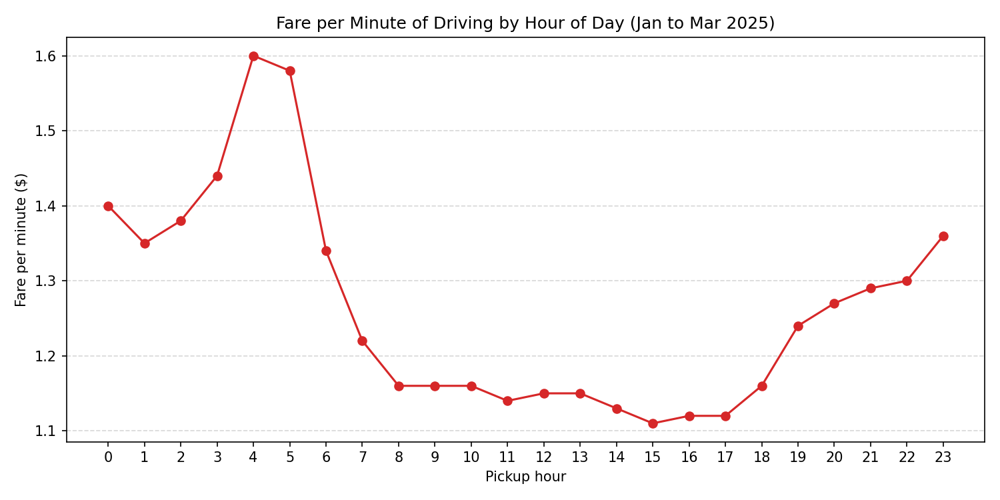
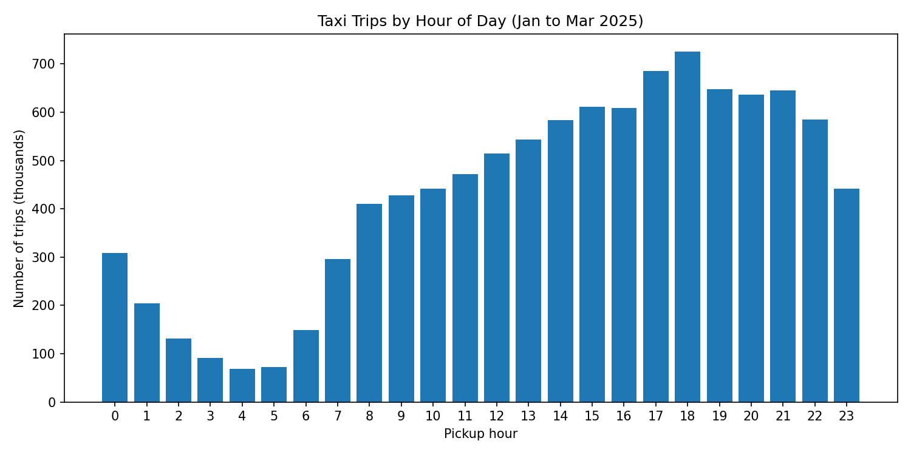
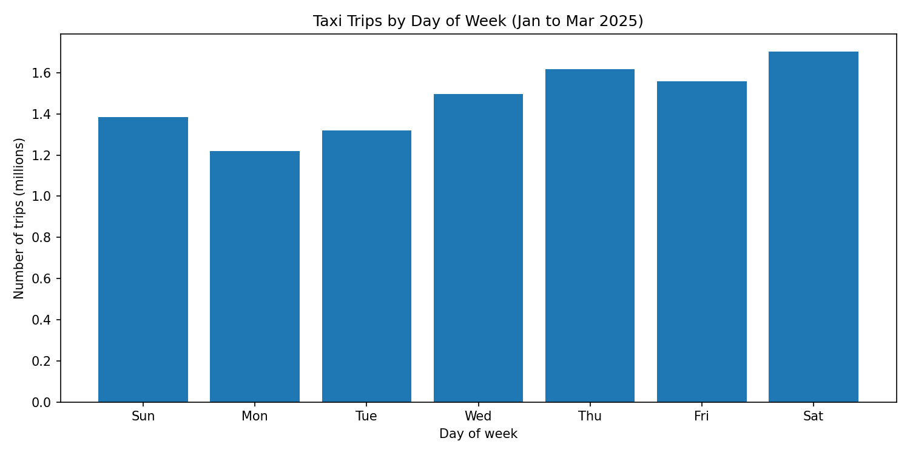
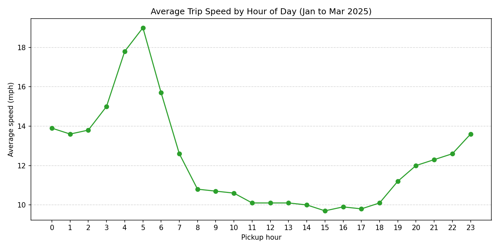
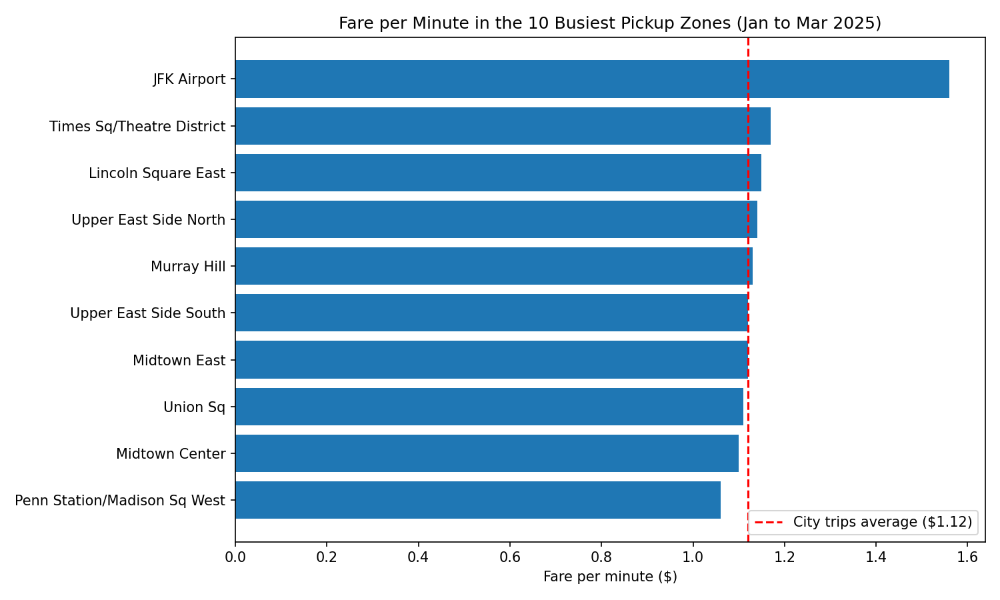
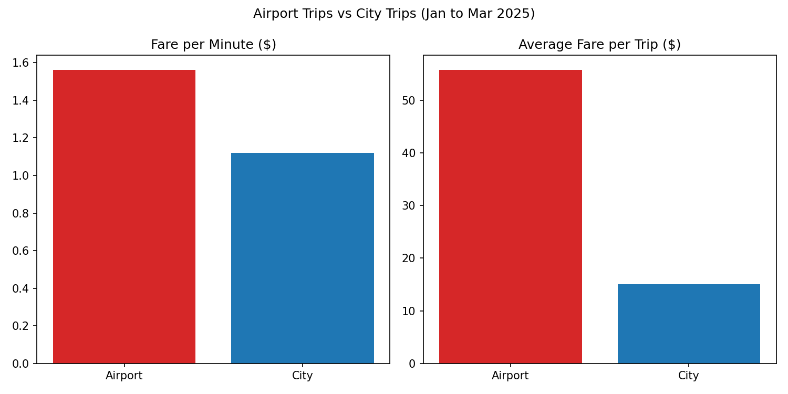
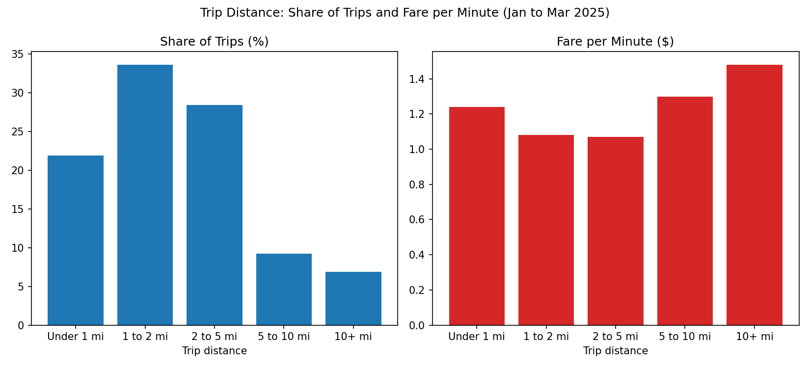

# NYC Taxi Analysis: Demand, Traffic Speed and Driver Earnings

A PySpark analysis of about 10 million NYC yellow taxi trips (January to March 2025). It looks at when and where demand is highest, when traffic is slowest, and when a driver's time earns the most.



## Problem Statement

A taxi fleet operator in New York wants to schedule its drivers more effectively. Demand changes a lot through the day and across the city, and a driver in the wrong place at the wrong time wastes time and fuel. The operator needs to know when and where demand is highest, and when trips are most worth the driver's time, in order to decide which shifts and areas need the most drivers.

## Questions Answered

1. When is demand highest, by hour of day and day of week?
2. Which pickup zones are the busiest?
3. When is traffic slowest?
4. When is a driver's time worth the most (fare per minute)?
5. Do airport trips earn more per minute than city trips?
6. How far do most trips go, and how does the fare per minute change with distance?

## Dataset

- **Source:** NYC Taxi and Limousine Commission (TLC) Trip Record Data, Yellow Taxi Trip Records
- **Period:** January to March 2025
- **Size:** 11,198,026 trips before cleaning, 10,303,408 after cleaning
- **Zone names:** TLC Taxi Zone Lookup Table (`data/taxi_zone_lookup.csv`)

The trip files are too large for GitHub, so they are not included in this repository. See "How to Run" below.

## Tools Used

- **PySpark** : loading, cleaning and grouping the large dataset
- **matplotlib:** charts 

## Process

**1. Loading**
- Read the three monthly Parquet files and combined them into one table (11,198,026 rows).

**2. Data quality checks**
- Found impossible values: pickup dates outside the period (back to 2007), negative and extremely large fares, trip distances of 0 and over 300,000 miles, and trips that ended before they started.

**3. Cleaning**
- Pickup date inside January to March 2025
- Dropoff time after pickup time
- Trip distance above 0 and at most 100 miles
- Fare between $3 and $500
- Trip duration between 1 and 180 minutes
- Average speed between 1 and 80 mph
- Fare per minute of at most $10
- Result: 894,618 rows removed (about 8.0%), 10,303,408 trips kept.

**4. New columns**
- Trip duration, pickup hour, day of week, average speed and fare per minute.
- Fare per minute uses the meter fare (`fare_amount`) divided by trip duration. Tips, tolls and fees (including the congestion fee) are not included.

**5. Analysis**
- Grouped the data with PySpark by hour, day, pickup zone, trip type (airport or city) and distance band.
- Fare per minute for a group is the total fare divided by the total minutes of that group.
- Zone rankings by fare per minute only include zones with at least 10,000 trips.

**6. Charts**
- The small summarized tables were converted to pandas and plotted with matplotlib.

## Findings

**Demand**
- The busiest hour is 6 PM (725,845 trips) and the quietest is 4 AM (68,055 trips). The hours from 5 PM to 9 PM account for about 32% of all trips.
- Saturday is the busiest day and Monday the quietest. Saturday has about 40% more trips than Monday.
- Demand is concentrated in a few places. 9 of the 10 busiest pickup zones are in Manhattan, and the only exception is JFK Airport. The 10 busiest zones together make up about 36% of all trips. Midtown Center is the busiest (483,063 trips).

**Traffic**
- Traffic is slowest around 3 PM (9.7 mph) and fastest at 5 AM (19.0 mph). From 8 AM to 6 PM the average speed stays at about 10 to 11 mph.

**Earnings per minute**
- The highest fare per minute is at 4 AM ($1.60) and the lowest at 3 PM ($1.11). That makes 4 AM about 44% higher, even though it has far fewer trips.
- The hours with the most trips are not the best paid. The slow afternoon traffic is a likely explanation, because the meter keeps running while the taxi covers fewer miles.
- The busiest Manhattan zones earn about the city average or less. Midtown Center earns $1.10 per minute and Penn Station $1.06, with average speeds under 9 mph. JFK is the exception, with $1.56 per minute at 25.2 mph.

**Airport vs city trips**

| | Airport | City |
|---|---|---|
| Trips | 841,242 | 9,462,166 |
| Fare per minute | $1.56 | $1.12 |
| Average fare | $55.71 | $15.03 |
| Average distance | 13.4 mi | 2.3 mi |
| Average duration | 35.6 min | 13.4 min |

Airport trips earn about 39% more per minute and have an average fare about 3.7 times higher, but make up only about 8% of all trips.

**Trip distance**
- About 55% of trips are under 2 miles and about 84% are under 5 miles.
- The highest fare per minute is on trips of 10 miles or more ($1.48). The middle distances (1 to 5 miles) pay the least, at about $1.07 to $1.08 per minute.

## Charts

| | |
|---|---|
|  |  |
|  |  |
|  |  |

## Recommendations

- Put the most cars on in the evening (5 PM to 9 PM), mainly in Midtown and the Upper East Side, where most trips start.
- Avoid adding extra cars in the mid-afternoon (2 PM to 5 PM), when traffic is slowest and the fare per minute is lowest.
- Keep good coverage at JFK and LaGuardia, because airport trips pay the most per minute.
- Early-morning shifts (3 AM to 5 AM) suit drivers who can take airport runs, since the fare per minute is highest then.

## Limitations

- The data covers only three winter months, so seasonal changes cannot be seen.
- The data contains completed trips only. It does not show how long a driver waits for a passenger or drives empty, so "fare per minute" is earnings while carrying a passenger, not earnings per hour worked. The early-morning and airport results may look weaker once waiting time is counted.
- Only the meter fare is used. Tips, tolls and fees are excluded.
- Some trips have an unknown pickup zone and are left out of the zone rankings.
- Charts that move together (for example speed and fare per minute) do not prove that one causes the other.
- The cleaning limits (for example 100 miles, $500, 80 mph) are judgment calls, and different limits would change the numbers slightly.

## Repository Structure

```
nyc-taxi-driver-scheduling/
├── notebook/   nyc_taxi_analysis.ipynb
├── charts/     PNG charts used in this README
├── data/       taxi_zone_lookup.csv
└── README.md
```

## How to Run

1. Download the yellow taxi trip files for January, February and March 2025 (Parquet) from the NYC TLC Trip Record Data page: https://www.nyc.gov/site/tlc/about/tlc-trip-record-data.page
2. Upload them, together with `data/taxi_zone_lookup.csv`, to a folder in Google Drive.
3. Open `notebook/nyc_taxi_analysis.ipynb` in Google Colab and update the `path` variable to point to that folder.
4. Run all cells. After cleaning, the table should have 10,303,408 rows.
